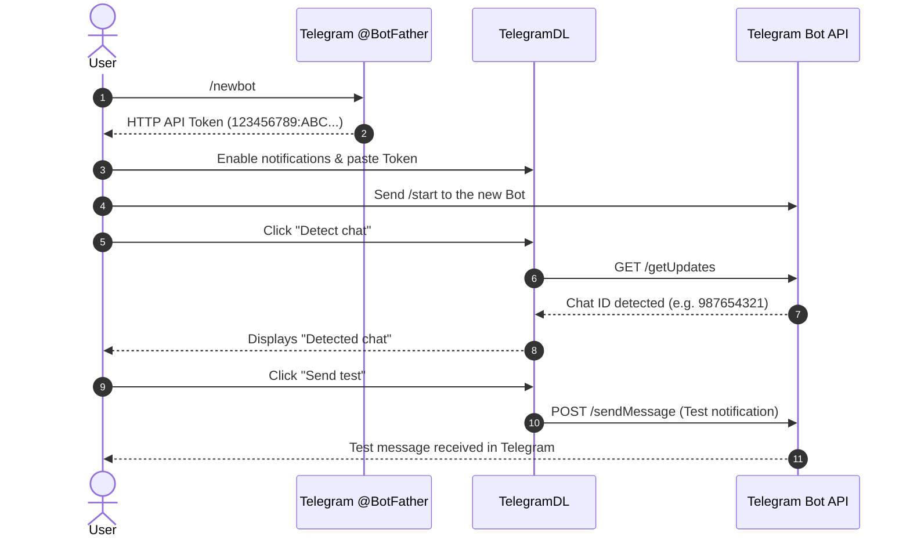

The **Settings** view in TelegramDL allows you to customize download engine performance, visual appearance, language, remote access, data export, and automatic notifications using your own Telegram bot.

All configuration is persisted locally in the system's SQLite database (`.tgdown/tgdown.sqlite3`) and automatically synchronized whenever changes are made.

---

## 1. Download Configuration

Controls network engine performance and file organization on disk:

- **Concurrent downloads**: Sets how many files download simultaneously (from 1 to 32, default 3).
- **Parallel Chunks**: Enables parallel chunked downloading in 512 KB segments directly over the MTProto protocol.
- **Workers per file**: Number of concurrent parallel threads assigned to each download (from 1 to 8, default 4). Increasing this saturates bandwidth for large files.
- **Global speed limit**: Sets a maximum total download rate in `KB/s`, `MB/s`, or `GB/s`. Enter `0` to disable speed limiting.
- **Download folder**: System destination directory where completed files are saved. Includes an interactive folder picker.
- **Subfolder per chat (Listener)**: When enabled, files downloaded from the **Listener** tab are automatically organized in subfolders named after the source chat or channel (or its numeric ID if non-printable characters are present).
- **Minimize to System Tray**: When minimizing the main desktop application window, it hides in the system notification area (near the taskbar clock) to keep downloads running in the background. Shows a native toast with panel audio when the queue completes.

---

## 2. Themes & Color

Customizes accent colors and visual panel styles:

- **Accent Color and Theme**:
  - **Telegram**: 16 official Telegram Premium color variants (flat colors and gradients).
  - **Thematic colors**: Advanced custom themes designed for the panel interface.
  - **Reset account color**: Reverts to your default Telegram account accent color.
- **Loader Color**:
  - Allows separate customization of the circular progress indicator (spinner/loader) color independently from the main theme.
  - **Reset loader color**: Re-synchronizes the loader color with the primary accent color.

---

## 3. Language

TelegramDL includes full multilingual support:

- **Available languages**: **Spanish** and **English**.
- Upon first launch, TelegramDL automatically detects your operating system language.
- Your selected language applies in real time to both the panel interface and formatted entries in the **Activity Log**.

---

## 4. Remote Access

Allows controlling TelegramDL from other devices (smartphones, tablets, or other PCs) via web browser or REST API endpoints.

- **Bearer Access Token**: Secret authentication token generated by the server.
- **Available Actions**:
  - **Show / Hide**: Toggles token visibility on screen.
  - **Copy**: Copies token directly to your clipboard.
  - **Regenerate token**: Invalidates the existing token and generates a new one.
  - **Send to my Telegram**: Sends a copy of the token directly to your Telegram **Saved Messages** chat with a single click, allowing easy copying on your mobile device.

:::tip[Security Recommendation]
Do not expose TelegramDL's IP and port directly to the public internet without protection. Use a VPN mesh like [Tailscale](https://tailscale.com) or a secure tunnel like Cloudflare Tunnel for safe remote access.
:::

---

## 5. Telegram & Download Notifications

TelegramDL can send push notifications to your phone or PC when downloads complete, errors occur, or the queue empties, using a **private Telegram bot**.

### Step-by-Step Guide: How to Create and Configure Your Notification Bot

#### Step 1: Create the Bot in Telegram via @BotFather
1. Open Telegram and search for the official account **`@BotFather`** (or open [https://t.me/BotFather](https://t.me/BotFather)).
2. Start the chat and send the `/newbot` command.
3. `@BotFather` will prompt you for a **display name** for your bot (e.g. `TelegramDL Notifier`).
4. Next, it will ask for a unique **username** that must end in `bot` (e.g. `my_tgdown_bot` or `MyTgDownNotifierBot`).
5. `@BotFather` will reply with a confirmation message containing your **HTTP API Access Token**. The token format looks like:
   `123456789:ABCdefGHIjklMNOpqrsTUVwxyz`

#### Step 2: Enter the Token in TelegramDL
1. In TelegramDL, go to **Settings** -> **Telegram & Download Notifications**.
2. Check the **"Enable notifications"** box.
3. Paste the received token into the **Bot token** field.

#### Step 3: Start Conversation & Detect Chat
1. In Telegram, open the chat with your newly created bot and tap **`START`** or send `/start`. *(This step is required so Telegram allows the bot to send you messages).*
2. In TelegramDL, click the **"Detect chat"** button.
3. TelegramDL will query bot updates and automatically fill in your **Chat ID** and user name.

#### Step 4: Optional Topic ID & Test Message
- **Topic ID (optional)**: If you want notifications sent to a specific topic within a forum supergroup, specify its `message_thread_id`. Leave empty for standard private chats.
- Click **"Send test"**: TelegramDL sends a test notification to confirm integration is active.

#### Step 5: Configure Received Files Naming Mode
- **Received files naming mode**: You can choose between **Automatic** and **Manual (choose between caption and original)**.
  - When sending Telegram links or uploading/forwarding media files (videos, audio, documents, photos) to your bot, it adds them to the download queue.
  - In **Manual** mode, if the file includes a caption, the bot sends an interactive message with two buttons (`Original name` and `Caption`) so you can select which name to save it as.

#### Quick Toggle from Sidebar
Once configured, you can turn automatic alerts on or off at any time using the **«Bot alerts»** button (bot icon) in the left sidebar.

---

## 6. Data & Backup

Allows backing up and managing system data:

- **Export Listener**: Downloads a JSON file (`tgdown-escucha-*.json`) containing all monitored chats, rules, and filters from Listener Mode.
- **Import Listener**: Restores or merges a previously exported listener configuration file. Existing chats are preserved while incoming chats are added or updated.
- **Clear history**: Purges records of completed, skipped, failed, and cancelled downloads from the SQLite database.
  
:::note
Clearing history **never deletes physical files** from your hard drive.
:::

---

## 7. Additional Sidebar Controls

- **Power off when done**: Toggling «Apagar al terminar» arms automatic PC shutdown 15 seconds after the download queue empties. Displays a live countdown while active. *(Session-only setting)*.
- **App sound**: Toggles audio alerts when downloads complete (both in the web panel and in System Tray notifications when minimized).
- **Log out of Telegram**: Safely closes the active Telegram session without removing local settings or database records.

:::tip[Complete Notifications Guide]
For detailed information on configuring and toggling bot alerts, panel chimes, or System Tray notifications, check the [Notification System](/TelegramDL/en/notifications) guide.
:::
