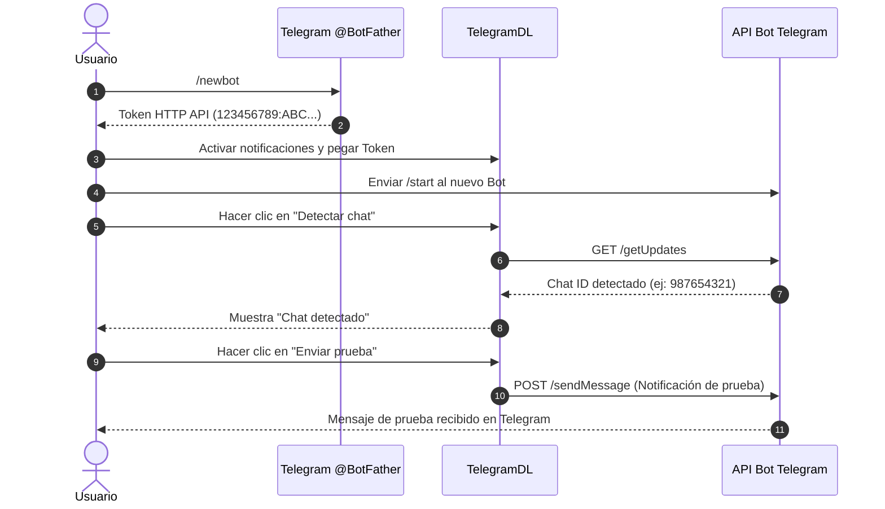

La pestaña **Ajustes** de TelegramDL permite personalizar el comportamiento del motor de descargas, la apariencia visual, el idioma, el acceso remoto, la exportación de datos y las notificaciones automáticas mediante un bot propio de Telegram.

Toda la configuración se persiste localmente en la base de datos SQLite del sistema (`.tgdown/tgdown.sqlite3`) y se sincroniza automáticamente al realizar cualquier cambio.

---

## 1. Configuración de Descarga

Controla el rendimiento del motor de red y la organización de archivos en disco:

- **Descargas simultáneas**: Define cuántos archivos se transfieren al mismo tiempo (de 1 a 32, por defecto 3).
- **Partes simultáneas (Parallel Chunks)**: Activa la fragmentación paralela de archivos en bloques de 512 KB directamente sobre el protocolo MTProto.
- **Workers por archivo**: Cantidad de hilos paralelos por cada descarga (de 1 a 8, por defecto 4). Aumentar este valor acelera archivos grandes saturando el ancho de banda.
- **Límite global de velocidad**: Establece una velocidad máxima de descarga global en `KB/s`, `MB/s` o `GB/s`. Introduce `0` para quitar el límite de velocidad.
- **Carpeta de descargas**: Ruta del sistema donde se guardarán los archivos completados. Incluye un explorador integrado de carpetas.
- **Carpeta por chat (escucha)**: Al activar esta opción, los archivos descargados desde la pestaña **Escucha** se organizan automáticamente en subcarpetas nombradas según el chat o canal de origen (o su ID numérico si contiene caracteres no válidos para el sistema de archivos).
- **Minimizar al System Tray**: Al minimizar la ventana principal en la aplicación de escritorio, esta se oculta en la bandeja del sistema (área de notificación junto al reloj) para continuar las descargas en segundo plano. Si la cola de trabajo finaliza mientras está minimizada, enviará una notificación nativa con el sonido del panel.

---

## 2. Temas y Color

Permite personalizar los colores de acento y los estilos del panel de control:

- **Color de Acento y Tema**:
  - **Telegram**: 16 variantes de color oficiales correspondientes a los temas de Telegram Premium (colores planos y degradados).
  - **Colores temáticos**: Paletas temáticas avanzadas para la interfaz del panel.
  - **Restablecer color de la cuenta**: Vuelve a aplicar el color de acento asignado por defecto a tu cuenta de Telegram.
- **Color de Loader**:
  - Permite personalizar individualmente el color del indicador circular de progreso (spinner/loader) independientemente del tema principal.
  - **Restablecer color del loader**: Vuelve a sincronizar el color del loader con el color de acento principal.

---

## 3. Idioma

TelegramDL incluye soporte multilingüe completo:

- **Idiomas disponibles**: **Español** e **Inglés**.
- La primera vez que ejecutas TelegramDL, el sistema detecta automáticamente el idioma de tu sistema operativo.
- El idioma seleccionado se aplica en tiempo real tanto a la interfaz del panel web como a los mensajes formateados en el **Registro de Actividad (Logs)**.

---

## 4. Acceso Remoto

Permite controlar TelegramDL desde otros dispositivos (smartphones, tablets u otras computadoras) a través de un navegador web o mediante llamadas a la API REST.

- **Token de acceso Bearer**: Token secreto de autenticación generado por el servidor.
- **Opciones disponibles**:
  - **Mostrar / Ocultar**: Permite visibilizar el token en pantalla.
  - **Copiar**: Copia el token directamente al portapapeles.
  - **Regenerar token**: Invalida el token anterior y genera uno nuevo.
  - **Enviármelo a Telegram**: Envía una copia del token directamente a la conversación de **Mensajes guardados** de tu cuenta de Telegram con un solo clic, permitiéndote copiarlo cómodamente desde tu móvil.

:::tip[Recomendación de Seguridad]
No expongas la IP y puerto de TelegramDL directamente a internet sin protección. Utiliza una red VPN como [Tailscale](https://tailscale.com) o un túnel seguro como Cloudflare Tunnel para un acceso remoto protegido.
:::

---

## 5. Notificaciones por Telegram y Descarga

TelegramDL puede enviarte notificaciones push instantáneas a tu teléfono o computadora cuando se completan descargas, ocurren errores o se vacía la cola de trabajo, utilizando un **bot privado de Telegram**.

### Guía Paso a Paso: Cómo Crear y Configurar tu Bot de Notificaciones

#### Paso 1: Crear el Bot en Telegram con @BotFather
1. Abre tu aplicación de Telegram y busca el contacto oficial **`@BotFather`** (o haz clic en [https://t.me/BotFather](https://t.me/BotFather)).
2. Inicia el chat y envía el comando `/newbot`.
3. `@BotFather` te pedirá un **nombre** para el bot (ejemplo: `Notificador TelegramDL`).
4. A continuación, te pedirá un **nombre de usuario (username)** único que debe terminar en `bot` (ejemplo: `mi_tgdown_bot` o `MiTgDownNotifierBot`).
5. `@BotFather` te responderá con un mensaje de confirmación que contiene el **Token de acceso HTTP API**. El token tiene un formato similar a:
   `123456789:ABCdefGHIjklMNOpqrsTUVwxyz`

#### Paso 2: Introducir el Token en TelegramDL
1. En TelegramDL, ve a **Ajustes** -> **Notificaciones por Telegram y Descarga**.
2. Marca la casilla **"Activar notificaciones"**.
3. Pega el token recibido en el campo **Token del bot**.

#### Paso 3: Iniciar la Conversación y Detectar el Chat
1. En tu aplicación de Telegram, abre el chat con el bot que acabas de crear y presiona el botón **`INICIAR`** o envíale el comando `/start`. *(Este paso es obligatorio para que Telegram permita al bot enviarte mensajes).*
2. En TelegramDL, haz clic en el botón **"Detectar chat"**.
3. TelegramDL consultará los eventos del bot y rellenará automáticamente el campo **ID del chat** con tu identificador numérico, mostrando el nombre de tu usuario.

#### Paso 4: Configurar Tema (Opcional) y Probar Conexión
- **ID del tema (opcional)**: Si deseas recibir las notificaciones en un canal o grupo con temas (topics), puedes especificar el `message_thread_id` en este campo. Para chats privados convencionales, déjalo vacío.
- Haz clic en **"Enviar prueba"**: TelegramDL enviará un mensaje de prueba a tu chat para confirmar que la integración funciona correctamente.

#### Paso 5: Configurar el Modo de Renombrado de Archivos Recibidos
- **Nombre de archivos recibidos**: Puedes elegir entre **Automático** y **Manual (seleccionar entre caption y original)**.
  - Al enviarle enlaces de Telegram o subir/reenviar archivos multimedia (vídeos, audios, documentos, fotos) a tu bot, este los añadirá a la cola de descargas.
  - En modo **Manual**, si el archivo incluye un pie de foto (*caption*), el bot te enviará un mensaje interactivo con dos botones (`Nombre original` y `Caption`) para que elijas con cuál guardarlo.

#### Control Rápido desde la Barra Lateral
Una vez configurado el bot en Ajustes, puedes activar o desactivar el envío de alertas automáticas en cualquier momento presionando el botón **«Avisos del bot»** (icono de bot) en la barra lateral izquierda del panel.

---

## 6. Datos y Respaldo

Permite respaldar y administrar la información almacenada en el sistema:

- **Exportar escucha**: Descarga un archivo JSON (`tgdown-escucha-*.json`) con la lista completa de chats vigilados en el Modo Escucha, incluyendo sus nombres, reglas y filtros configurados.
- **Importar escucha**: Permite restaurar o fusionar un archivo de configuración de escucha previo. La importación conserva los chats existentes y añade o actualiza los del archivo importado.
- **Limpiar historial**: Elimina de la base de datos el historial de descargas completadas, omitidas, fallidas y canceladas.
  
:::note
La acción de limpiar historial **nunca elimina los archivos físicos** descargados en el disco duro.
:::

---

## 7. Opciones Adicionales de la Barra Lateral

- **Apagar al terminar**: Al activar el interruptor «Apagar al terminar» en la barra lateral, el equipo se apagará automáticamente 15 segundos después de que la cola de descargas quede totalmente vacía. Mientras esté activo, se mostrará una cuenta atrás en vivo. *(Ajuste temporal por sesión)*.
- **Sonido de la app**: Activa o desactiva las alertas sonoras al finalizar una descarga (tanto en el panel web como en las notificaciones del System Tray al estar minimizado).
- **Cerrar sesión de Telegram**: Cierra de forma segura la sesión activa de Telegram sin borrar tus ajustes locales ni la base de datos.

:::tip[Guía Completa de Notificaciones]
Para información detallada sobre cómo configurar y activar/desactivar las alertas del bot, tonos del panel o notificaciones del System Tray, consulta la guía del [Sistema de Notificaciones](/TelegramDL/notifications).
:::
